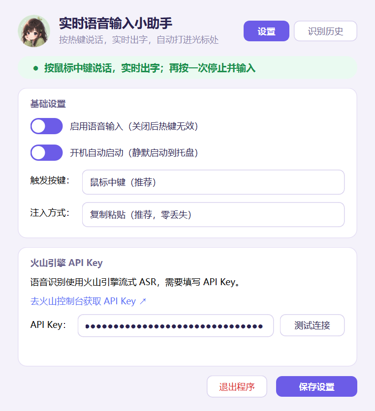

# 实时语音输入小助手

实时语音输入助手：按全局热键（默认鼠标中键）开始录音，火山豆包流式 ASR
**边说边出字**——说话过程中识别结果实时显示，再按一次热键停止，文字自动
注入当前光标处。它不是输入法、不接管键盘，任何应用的输入框都能用。

## 快速开始（使用 exe）

1. 到 [Releases 页面](https://github.com/HeXiaoShu520/voice-input-assistant/releases/latest) 下载 `VoiceInputAssistant-v1.0.0.exe`
2. 放到任意文件夹（例如 `D:\语音输入小助手`），**双击运行**——主界面会自动弹出
3. 首次运行若 Windows 提示「已保护你的电脑」：点 **更多信息 → 仍要运行**（程序未做代码签名，属正常提示）
4. 点主界面的「**① 开通语音服务（购买/激活）**」链接，完成火山语音服务的开通（有免费额度）
5. 点「**② 获取 API Key**」链接创建密钥并复制 → 填入设置页 → 「测试连接」显示「连接成功 ✓」→ 点 **保存设置**
6. 按下触发按键（默认鼠标中键）开始说话，实时出字；**再按一次停止**，文字自动打进当前输入框
7. 主界面顶部「设置 / 识别历史」随时切换；关闭主界面只是最小化到托盘，语音输入继续可用
8. 想退出：托盘右键 → 退出，或主界面「退出程序」

> 触发按键可换成鼠标侧键、右Alt（轻点判定）或 F8-F10；勾选「开机自动启动」后每次开机静默运行在托盘。API Key 在[火山引擎语音控制台](https://console.volcengine.com/speech/new/setting/apikeys?projectName=default)获取。

## 功能

- **实时流式识别，边说边出字**：说话过程中中间结果就实时上屏，不用说完再等
- **预览就在文字落点旁**：识别胶囊跟随热键按下的位置显示，视线不用在输入框和屏幕角落之间来回跳
- 全局热键触发：鼠标中键 / 鼠标侧键 / 右Alt / F8-F10，主界面可切换
- 双击 exe 打开主界面：顶部「设置 / 识别历史」两个可切换页面；关闭主界面
  只是最小化到托盘，语音输入继续可用
- 按下热键立即开麦缓冲音频，连接就绪后自动补发，话音不因握手延迟丢失
- 录音中悬浮胶囊实时显示识别文字；失败时红样式提示具体原因（超时 / 401 / 403 等）
- 停止后识别文字自动注入光标处（默认复制粘贴，可改模拟打字）
- 识别历史：主界面的「识别历史」页（点击条目复制文字，保留最近 200 条）；
  单击或双击托盘图标即可打开主界面
- 单实例运行：重复启动自动退出并提示；退出前弹确认框防误触
- 通知为应用自绘气泡（屏幕底部居中），不依赖 Windows 系统通知开关
- 开机自启动（HKCU 注册表，静默启动到托盘不弹窗）；exe 挪动位置后，下次启动自动修正注册表路径
- 单次录音上限 5 分钟，到时自动结束并注入已识别内容

## 触发按键

在主界面的「触发按键」里选择（双击 exe，或单击托盘图标打开主界面）：

| 选项 | 配置值 | 说明 |
| --- | --- | --- |
| 鼠标中键（推荐） | `mouse:middle` | |
| 鼠标侧键1 / 侧键2 | `mouse:x1` / `mouse:x2` | 即后退键 / 前进键 |
| 右Alt | `key:alt_r` | 修饰键走"轻点"判定：按下并松开、期间未按其他键才触发，Alt+Tab 等组合键不会误触；兼容上报为 `alt_gr` 的键盘布局 |
| F8 / F9 / F10 | `key:f8` 等 | 普通按键，按下即触发 |

### 和输入法自带语音的区别

本工具是一个独立程序，不是输入法，也不依赖任何输入法：

| | 本工具 | 输入法自带的语音 |
| --- | --- | --- |
| 触发 | 全局热键一键开始/停止，浏览器、聊天窗口、编辑器等任意应用内都能用 | 一般需要先切到对应输入法，再点它的语音按钮 |
| 与输入法的关系 | 不切换、不接管输入法，平时打字习惯完全不变 | 绑定在对应输入法上，换输入法就失效 |
| 识别过程 | 流式 ASR，边说边出字；单次最长 5 分钟 | 上屏方式因输入法而异，通常说完一段才出结果 |
| **预览位置** | **跟随热键按下的位置**：预览就显示在文字将要落入的输入框旁，视线不挪窝 | 统一固定在屏幕中下方的悬浮窗里，看预览和看落点要来回切换 |
| 文字写入 | 识别结果以复制粘贴方式写入光标处，绕开输入法干扰，中文长文本零丢失 | 经输入法上屏，可能受输入法当前状态影响 |

## 界面预览

| 设置 | 识别历史 |
| --- | --- |
|  |  |

录音时，识别预览胶囊直接出现在你按下热键的位置附近，边说边出字：


## 从源码运行与打包（开发者）

```cmd
pip install -r requirements.txt
python main.py
```

或双击 `启动语音输入.cmd`（pythonw 静默启动，无控制台窗口）。

打包单文件 exe：

```cmd
pip install pyinstaller
python -m PyInstaller voice_input.spec --noconfirm
```

产物在 `dist\实时语音输入小助手.exe`。

## 配置

启动时会打开主界面：填写火山引擎 API Key（点「测试连接」可直接验证是否
有效）、选择触发按键与注入方式，点「保存设置」立即生效；「启用语音输入」
和「开机自动启动」两个开关改动即生效。托盘菜单里有同样的开关和「打开主
界面…」入口，两处状态自动同步。

其余配置在数据目录的 `data/settings.json`，改完重启生效：

```json
{
  "enabled": true,
  "api_key": "火山引擎 API Key",
  "hotkey": "mouse:middle",
  "inject_mode": "paste"
}
```

| 键 | 说明 |
| --- | --- |
| `hotkey` | 见上方触发按键表（pynput 键名） |
| `inject_mode` | `paste` 复制粘贴（推荐，零丢失）；`typing` 模拟打字 |

## 数据目录

便携模式：exe（或源码）同级 `data\`，配置、识别历史、日志都在里面，
整个文件夹拷走即可搬家；目录不可写（如 exe 放在 Program Files）时自动
回退 `%APPDATA%\VoiceInput\`。旧版本写在 `%APPDATA%\VoiceInput\` 的配置
与历史，会在新位置首次运行时自动迁移过来。

日志在 `data/logs/voice_input.log`（1MB 轮转，保留 3 份备份）。

> `data\` 含 API Key 与个人语音记录，已被 `.gitignore` 排除，请勿提交或
> 随 exe 一起分发。
